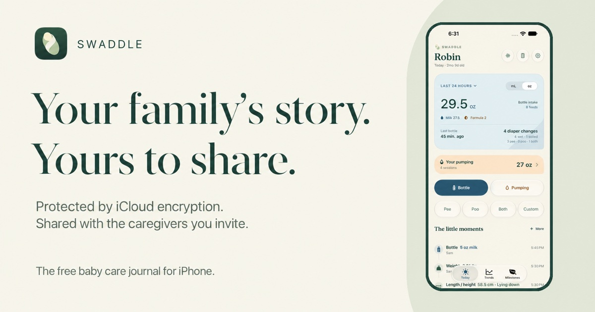
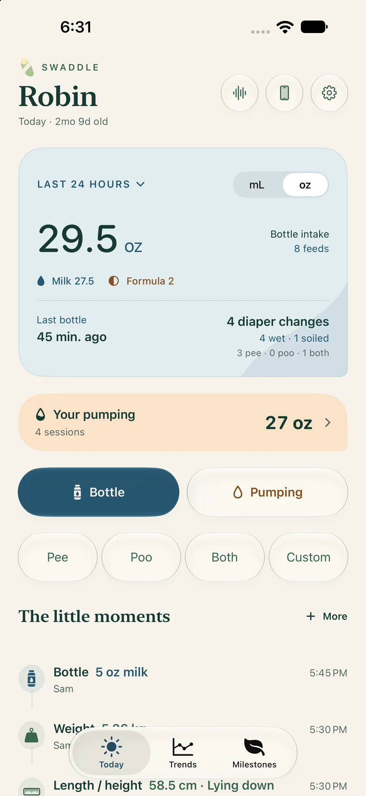
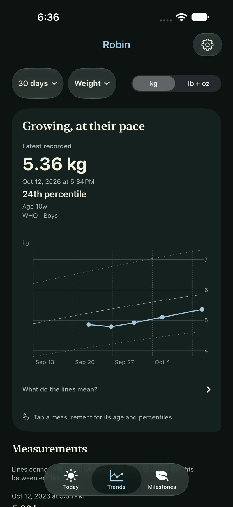
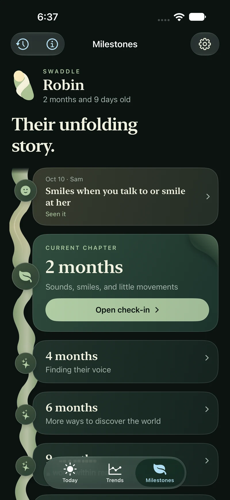

<p align="center">
  <a href="https://swaddle-ios.app">
    
  </a>
</p>

<p align="center">
  <strong>Your family’s story. Yours to share.</strong><br>
  Feeding, diapers, pumping, growth, and firsts — together in one calm family journal.<br>
  Protected by iCloud encryption. Shared with the caregivers you invite.
</p>

<p align="center">
  <a href="https://apps.apple.com/app/swaddle-newborn-log/id6814224127"><strong>Download on the App Store</strong></a> ·
  <a href="https://swaddle-ios.app">Explore Swaddle</a> ·
  <a href="https://swaddle-ios.app/support/">Support</a> ·
  <a href="https://swaddle-ios.app/privacy/">Privacy</a> ·
  <a href="#build-it-yourself">Build it yourself</a>
</p>

<p align="center">
  <strong>Completely free</strong> &nbsp; / &nbsp; iPhone · iOS 26+ &nbsp; / &nbsp; 14 languages &nbsp; / &nbsp; MPL 2.0
</p>

---

## A little less to remember

Was that the last bottle, or the one before? Who changed the diaper? How much did we pump today?

Swaddle keeps the small details close, so the people caring for a baby can pick up where each other left off. It is a native SwiftUI app with iCloud family sharing, quick widgets, Siri actions, and a quiet place for the moments you want to remember.

**No ads. No subscriptions. No in-app purchases.** Every feature, for every caregiver.

<table>
  <tr>
    <th align="center">The day, at a glance</th>
    <th align="center">Growth, with context</th>
    <th align="center">Their unfolding story</th>
  </tr>
  <tr>
    <td width="33%"></td>
    <td width="33%"></td>
    <td width="33%"></td>
  </tr>
</table>

<p align="center"><sub>Real app screens. Fictional family data.</sub></p>

## Everything the next caregiver needs

| A moment of care | What Swaddle keeps track of |
| :--- | :--- |
| **Every way you feed** | Breast milk, formula, mixed bottles, and breastfeeding sessions. Remember previous amounts, enter an exact volume, or log an earlier time. |
| **The quick little changes** | One-tap **Pee**, **Poo**, or **Both**, with confirmation and Undo. Custom entries handle earlier changes and notes. |
| **A little set aside** | Pumping for each pumper, with total or left/right amounts. Any caregiver with editing access can log on their behalf. Expressed milk stays separate from the baby's intake. |
| **The days, a little clearer** | Today or a rolling 24 hours, interactive trends, exact chart values, and a readable activity history. Switch between mL and oz, or kg and lb + oz for weight. |
| **Growing, at their pace** | Weight, length/height, and head circumference over time, with WHO reference percentiles for supported ages. Compare corrected and actual age for a premature baby. |
| **Their firsts** | CDC milestone checklists from 2–24 months, WHO motor-development windows, and 106 original looping illustrations. Record a check-in, the exact first-noticed date, and a note. |

### One family, one log

Invite a partner, grandparent, or caregiver through iCloud using their own Apple Account. Give them viewing or editing access to the family's children, care history, pumping, and milestone observations. See who recorded each entry, review changes, and merge duplicate caregiver profiles without losing their history.

Entries save on the device first. iCloud carries them to the other caregivers when a connection is available. The cloud status control shows progress and offers **Sync now**; the activity list also supports pull to refresh.

### When your hands are full

Home Screen widgets combine the last 24 hours of bottles, pumping, and diapers with quick actions. Individual **Pee**, **Poo**, **Both**, and **Bottle** widgets are also available for the Home and Lock Screens.

Or ask Siri:

> “Record a diaper in Swaddle.” → “Both.”
>
> “Record a bottle in Swaddle.”
>
> “How much did my baby eat in Swaddle?”

Diaper widgets save through the app after authentication. Bottle opens the editor so you can check the amount. Siri support depends on the device, language, and system settings.

### Thoughtful, day and night

Warm ivory in the light. Deep forest in the dark. A folded intake card, a thread through the timeline, and gentle celebrations for little birthdays and pumping records. Native controls, larger text, and Reduce Motion support keep the interface familiar and adaptable.

English · Español · العربية · Português (Brasil) · فارسی · Français · Kreyòl ayisyen · हिन्दी · 한국어 · 简体中文 · Soomaali · Filipino · Tiếng Việt · Русский

## Your family's care belongs to your family

**Protected by iCloud encryption. Shared with the caregivers you invite.** Apple’s iCloud protects synchronized data in transit and at rest.

Swaddle has **no developer-run journal server, advertising, or third-party analytics**. It stores records locally and uses Apple's private and shared CloudKit databases for sync. Widgets use an on-device cache. Care-note import is processed locally, and care-history discovery in Siri and system search can be turned off.

Read the [privacy policy](https://swaddle-ios.app/privacy/) for sharing permissions, Apple services, support correspondence, and deletion controls.

Growth references and milestone checklists help organize observations for a conversation with your child's clinician. They are not diagnoses, feeding targets, or a developmental screening test. CDC and WHO do not endorse Swaddle. Volume entry and display use **1 oz = 30 mL**.

## Get Swaddle

**[Download Swaddle free on the App Store](https://apps.apple.com/app/swaddle-newborn-log/id6814224127)** for iPhone with iOS 26 or later. Every feature is included, with no ads, subscriptions, or in-app purchases.

The source is available now, under the **Mozilla Public License 2.0**.

## Build it yourself

The app runs on **iPhone with iOS 26 or later**. The checked-in project uses Xcode 27's `project.xcproj` format; development is currently verified with **Xcode 27.2**. Xcode resolves the Lottie dependency through Swift Package Manager.

```sh
git clone https://github.com/fkorotkov/swaddle-ios.app.git
cd swaddle-ios.app
open BabyActivityRecorder.xcodeproj
```

Select the **BabyActivityRecorder** scheme and an available iPhone simulator, then run. Choose **Start demo** from the welcome flow to explore Robin, Sam, and Alex's fictional family. Demo changes stay in memory and never reach iCloud, widgets, Siri, or your own family; **Exit demo** or fully closing the app ends the session. Simulator builds use local storage with CloudKit disabled.

For a physical-device build, configure your own signing team, app and widget bundle IDs, App Group, and CloudKit container. Keep the matching entitlements and identifiers in `PersistenceController` consistent. The repository does not include signing credentials. Changing containers creates a separate data space.

Run the core tests with:

```sh
swift test
```

Run the app-hosted tests through the shared scheme in Xcode. Family sharing also needs verification on two devices with different iCloud accounts; local tests alone cannot establish successful family sync.

<details>
<summary><strong>A map of the source</strong></summary>

| Location | What's inside |
| :--- | :--- |
| [`BabyActivityRecorder/Domain`](BabyActivityRecorder/Domain/) | Typed care records, validation, summaries, growth references, and milestone definitions. |
| [`BabyActivityRecorder/Persistence`](BabyActivityRecorder/Persistence/) | Local Core Data storage, the revision journal, CKSyncEngine, sharing, and widget snapshots. |
| [`BabyActivityRecorder/Features`](BabyActivityRecorder/Features/) | Today, Trends, Milestones, Settings, and the care editors. |
| [`BabyActivityRecorder/Design`](BabyActivityRecorder/Design/) | Colors, typography, reusable controls, illustrations, and motion. |
| [`BabyActivityRecorder/Intents`](BabyActivityRecorder/Intents/) · [`LittleLogWidgets`](LittleLogWidgets/) | Siri, App Intents, and Home and Lock Screen widgets. |
| [`Tests`](Tests/) · [`LittleLogTests`](LittleLogTests/) | Core regression and app integration tests. |
| [`ReferenceData`](ReferenceData/) | Official source provenance, reference fixtures, localization, and illustration tooling. |
| [`website`](website/) | The static website, support, and privacy pages published by GitHub Pages. |

Care records use immutable revisions. Edits retain their parents, competing changes remain reviewable, and a stale edit does not silently resurrect a deleted entry. CloudKit transports the shared records; local projections provide the interface and totals.

[Care data contract](docs/care-data.md) · [Import formats](IMPORT_FORMAT.md) · [iCloud synchronization](docs/icloud-sync.md) · [Siri & widgets](docs/siri-and-widgets.md) · [Website publishing](docs/website.md)

</details>

## Made together

Bug reports, accessibility improvements, translations, and thoughtful contributions are welcome. Open an [issue](https://github.com/fkorotkov/swaddle-ios.app/issues) with a reproducible example. Use fictional data and leave out family records, credentials, and private screenshots.

For personal support, email [support@swaddle-ios.app](mailto:support@swaddle-ios.app).

## License & acknowledgments

Copyright © 2026 Fedor Korotkov. Original Swaddle source, documentation, and artwork are licensed under the [Mozilla Public License 2.0](LICENSE). Third-party dependencies and reference materials retain their own terms; see [Third-party notices](THIRD_PARTY_NOTICES.md).

Thanks to the teams behind [Lottie](https://github.com/airbnb/lottie-ios), the [WHO Child Growth Standards](https://www.who.int/tools/child-growth-standards), and the [CDC milestone checklists](https://www.cdc.gov/act-early/milestones/index.html).

<p align="center"><sub>Your family’s story. Yours to share.</sub></p>
